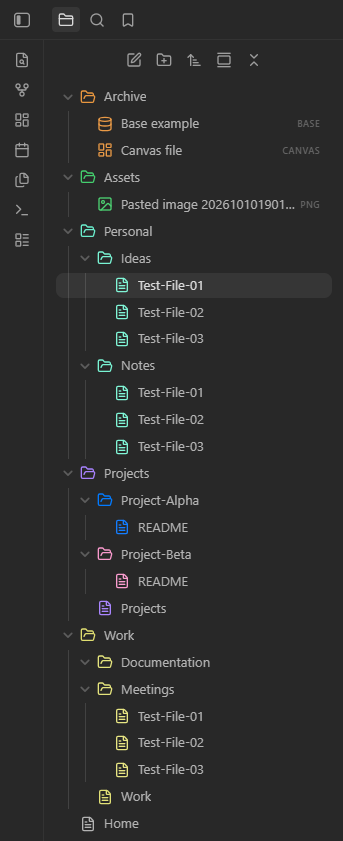
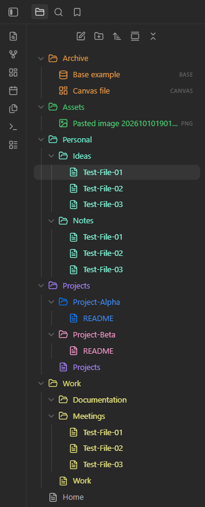
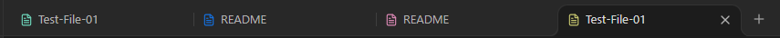

# Colors for Folders Files and Tabs

[](https://github.com/JhojanL/obsidian-plugin-colors-for-folders-files-and-tabs/actions/workflows/ci.yml)
[](https://github.com/JhojanL/obsidian-plugin-colors-for-folders-files-and-tabs/actions/workflows/release.yml)
[](https://github.com/JhojanL/obsidian-plugin-colors-for-folders-files-and-tabs/releases/latest)
[](LICENSE)

Make projects and sections of your vault easier to spot with folder colors.
Choose a color for a folder, and its files and subfolders follow along. Give any
subfolder its own color whenever you want it to stand out.

Use the built-in palette or create your own colors. Choose where they appear:
folder and file icons, tab icons, or names in the file explorer. Everything stays
local, and your notes remain untouched.

**Available for desktop Obsidian 1.14.4 or later.**

## Installation

Find the plugin in the [Obsidian community directory](https://community.obsidian.md/plugins/colors-for-folders-files-and-tabs),
or install it from Obsidian:

1. Open **Settings → Community plugins** and turn on community plugins if needed.
2. Select **Browse** and search for **Colors for Folders Files and Tabs**.
3. Select **Install**, then **Enable**.

For updates or manual installation, see the [user guide](docs/USER_GUIDE.md#installation).

## Features

- A named palette with built-in colors, custom hex values and a color picker.
- Folder colors that flow to files and subfolders, with subtle variations.
- Separate controls for file explorer icons, file explorer names and tab icons.
- Quick access through folder menus, settings and the command palette.
- Saved preferences with recovery guidance if settings cannot be loaded or saved.
- Offline use without accounts, telemetry or changes to your notes.

## See it in use

| Icons only (default)                                                                                                           | Icons and names (optional)                                                                                                                                   |
| ------------------------------------------------------------------------------------------------------------------------------ | ------------------------------------------------------------------------------------------------------------------------------------------------------------ |
|  |  |

**Color names is disabled by default.** Enable it in the plugin's Appearance
section to use the presentation on the right. Tab names keep the theme's styling.



Screenshots show the October 12, 2026 build in Obsidian **1.14.4**, with dark
appearance and synthetic **ColorsTest** content. The maintainer confirmed normal
operation. See the [image notes](assets/images/README.md).

## First use

1. Enable the installed plugin in **Settings → Community plugins**.
2. Open a folder's context menu and choose **Set folder color…**.
3. Select a named color and choose **Apply**.

Choose **Use inherited color** to clear an explicit assignment. Manage colors in
**Settings → Colors for Folders Files and Tabs → Palette**, or run **Manage palette**
from the command palette. See the [user guide](docs/USER_GUIDE.md) for inheritance,
appearance preferences and settings recovery.

## Windows Narrator compatibility

Use **Tab** to focus an Appearance switch and **Space** to toggle it. With Windows
Narrator enabled, first disable **Scan Mode** using **Caps Lock + Space**.
The maintainer verified this workflow in Obsidian **1.14.4**; the Narrator version
was not recorded. See [accessibility](docs/ACCESSIBILITY.md) for verification scope
and reporting guidance.

## Support and limitations

Verification covers the recorded Windows workflows. Current-build validation on
Linux/macOS and other themes is pending; mobile support and automated E2E tests
are future work. Unsupported surfaces keep native colors. Tracked pop-out cleanup
passed, but an earlier observation of two retained closed documents has no
established owner. See [testing](docs/TESTING.md#recorded-evidence-and-limitations).

Report ordinary bugs through the repository's issue forms. Report suspected
vulnerabilities privately using [SECURITY.md](SECURITY.md).

## Development and contribution

[Development](docs/DEVELOPMENT.md) covers setup and deployment.
[Releases](docs/RELEASE.md) covers release automation, configuration and recovery.
Use mise with Node **24.21.0**, pnpm **12.8.1** and the committed TypeScript **6.0.3**
pin. The full local check is:

```bash
mise exec -- pnpm run check
```

Start with [CONTRIBUTING.md](CONTRIBUTING.md), [architecture](docs/ARCHITECTURE.md)
and [testing](docs/TESTING.md). See the [changelog](CHANGELOG.md) for release history.

## Support development

If this plugin is useful to you, you can support its development on Ko-fi.
Donations are optional.

[](https://ko-fi.com/J7M828OH4E)

## License and provenance

[MIT](LICENSE). Contributors retain ownership of their work. This project began
with the official [Obsidian sample plugin](https://github.com/obsidianmd/obsidian-sample-plugin);
the original license and attribution are preserved in [NOTICE](NOTICE).
