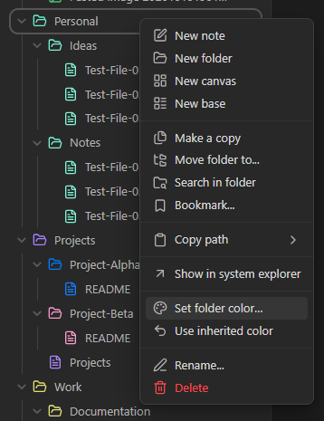
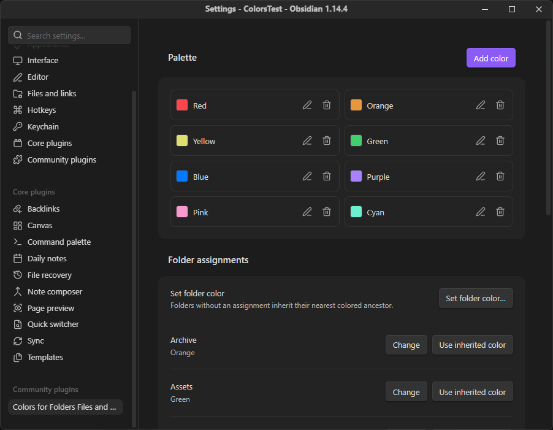
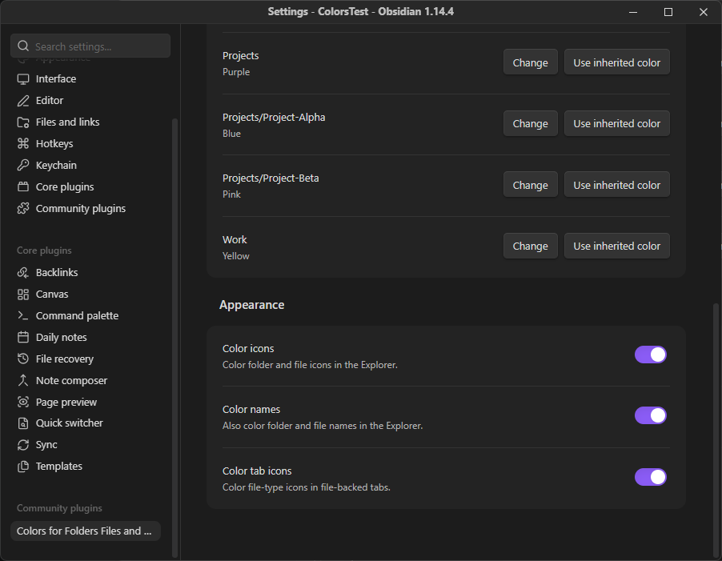

# User guide

The plugin colors folder/file icons, optional Explorer names and file-backed tab
icons. A folder's assignment applies to its descendants until another folder
overrides it. It uses local settings and vault path/type metadata; it never reads
or changes note contents.

## Installation

Use desktop Obsidian **1.14.4 or later**. Community-directory installation is not
available for this unreleased MVP.

1. Follow [development setup](DEVELOPMENT.md#setup), then run
   `mise exec -- pnpm run build` in the checkout.
2. Create `<vault>/.obsidian/plugins/colors-for-folders-files-and-tabs/`, replacing
   `.obsidian` if the vault uses a different configuration directory.
3. Copy only `main.js`, `manifest.json` and `styles.css` into that folder.
   Preserve any existing `data.json` when updating.
4. Open **Settings → Community plugins**, enable community plugins if needed,
   then enable **Colors for Folders Files and Tabs**. Reload the plugin after updates.

For development checks, use the dedicated synthetic **ColorsTest** vault and
[deployment workflow](DEVELOPMENT.md#test-in-windows-obsidian).

## Assign a folder color

Open a folder's context menu and choose **Set folder color…**, select a named
color, then choose **Apply**. **Cancel** or **Escape** discards the assignment
selection. Palette edits made inside the dialog are saved separately.

The command **Set folder color…** opens a searchable folder chooser. You can also
use the button in **Settings → Colors for Folders Files and Tabs → Folder assignments**.
Assignments apply to non-root folders; files receive their containing folder's color.

### Inheritance and overrides

| Assignment                              | Result                                     |
| --------------------------------------- | ------------------------------------------ |
| `Projects` → Purple                     | Its unassigned descendants inherit Purple. |
| `Projects/Project-Alpha` → Blue         | This branch inherits Blue instead.         |
| Clear Project-Alpha's assignment        | The branch inherits Purple again.          |
| Clear Projects with no colored ancestor | Unassigned descendants become neutral.     |

Use **Use inherited color** in the folder menu, assignment dialog or Settings
list to clear an explicit assignment. Other descendant overrides remain intact.
The menu action is disabled when the folder has no explicit assignment.

Folder renames/moves update stored assignment paths. Deleting a folder removes
assignments within that branch. The plugin observes those changes; it does not
move or delete folders. A Settings entry marked **Folder missing** can have its
stale assignment cleared.

## Edit the palette

Open the **Palette** section or run **Manage palette** from the command palette.

- **Add color** opens an editor for a name and six-digit hex value such as `#8b6cef`.
- **Edit** changes a color while retaining its assignments. The native picker and
  valid hex input stay synchronized. Choose **Apply** to save or **Cancel** to discard.
- **Delete** removes a palette entry. A referenced color requires confirmation;
  removing it clears its explicit assignments, restoring inheritance or neutrality.

Names must be nonempty and distinct. Duplicate names or resolved hex colors show
guidance and prevent Apply. Built-in colors follow the theme until their hex value
is changed. Previews and rendered colors adjust for contrast, so they may differ
from the entered seed.

## Appearance preferences

| Preference      | Default | Effect                                        |
| --------------- | ------- | --------------------------------------------- |
| Color icons     | On      | Colors folder and file icons in the Explorer. |
| Color names     | Off     | Colors folder and file names in the Explorer. |
| Color tab icons | On      | Colors icons in supported file-backed tabs.   |

Preferences are independent and preserve assignments. Tab names retain the
theme's styling. Native focus, selection and names remain usable without color.

This capture has **Color names** enabled; the default is off. All supplied images
show ColorsTest, Obsidian 1.14.4 and dark appearance. The maintainer confirms the
latest build; theme and capture hash are unspecified.

## Commands and keyboard use

**Set folder color…** chooses a folder; **Manage palette** opens palette management.
Neither command has a default hotkey. Assign one in Obsidian's **Settings → Hotkeys**.

Use **Tab / Shift + Tab** to move between controls, **Space** to activate a focused
switch or palette button, and **Escape** to cancel a dialog. With Windows Narrator,
disable Scan Mode using **Caps Lock + Space** before toggling switches. See
[accessibility](ACCESSIBILITY.md) for details and tested scope.

## Saving and recovery

Edits save automatically when applied. Controls involved in a save pause while it
is pending. A failed save keeps the edit visible for the current session and offers
**Retry saving** in Settings. Resolve the storage problem and retry before reloading
or closing Obsidian. Validation errors instead require correcting the input.

Damaged, unreadable or newer-format settings disable editing and preserve the
saved file. A first installation with no settings file remains writable; loading
alone does not save defaults or repair data.

If recovery is needed:

1. Close Obsidian and back up this plugin's exact `data.json` from its installation
   folder. Keep the backup outside the plugin folder.
2. For newer-format data, install a compatible newer plugin version. For damaged
   data, restore a known-good backup; for access failures, restore file access.
3. Reopen Obsidian and check the plugin's guidance before editing.

To deliberately start over, move the backed-up `data.json` out of the installation
folder while Obsidian is closed. Reopening uses the default palette and clears
previous assignments. There is no automatic repair or reset button.

## Get help

For missing colors, check the nearest folder assignment and the relevant Appearance
preference. Unsupported views or backgrounds that cannot be safely measured use
native foregrounds. Theme/snippet interactions may affect presentation.

Use the repository's bug form with plugin/app versions, operating system, theme
and reproduction steps using synthetic content. Include assistive technology for
accessibility issues. Keep private paths and settings out of public reports;
see [SECURITY.md](../SECURITY.md) for private vulnerability reporting.
